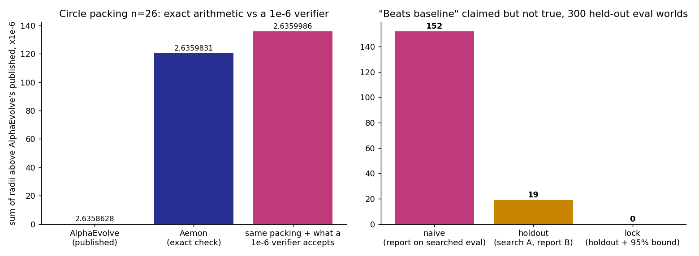

# evallock: certify "better" before a research loop claims it

> Unofficial prototype by Kushagra Pratap Singh. Not affiliated with Aemon.

## The problem
[Aemon](https://aemon.ai/) says "the eval comes before invention": a trusted eval should make "better" impossible to fake. A self-accelerating research loop is also the best tool there is for finding the eval's weak spots. Two show up constantly:

1. **Verifier slack.** Float checkers with a tolerance accept a little overlap or a little overhang. A search finds that and turns it into score.
   - **The public n=26 circle-packing results show the scale.** ShinkaEvolve's paper used OpenEvolve's verifier with **1e-6 slack** and reports 2.635983099. Its exact-check replication scored 2.635977709 ([arXiv 2509.19349](https://arxiv.org/abs/2509.19349), appendix).
   - **Claimed improvements in this problem are of the same order** (1e-7 to 1e-4).
2. **Adaptive overfitting.** A loop that "learns from every result" on one fixed eval set (Recall@10 on N queries, say) ends up fitting that set's quirks. The best score it reports is biased upward even when nothing truly improved.

## What I built
- **`evallock/packing.py`: exact certification.**
  - Rational-arithmetic checks with zero tolerance, comparing `d² ≥ (r1+r2)²` exactly and the walls exactly, plus 50-digit gap reports.
  - A **certified score**: the sum after the smallest uniform radius shrink that makes the packing exactly valid.
  - Works for the unit square (AlphaEvolve B.12) and perimeter-4 rectangles (B.13).
- **`evallock/slack.py`: what a tolerance is worth.**
  - At a local optimum, the KKT multipliers λ give the score a verifier with tolerance t hands out: about **t·Σλ**. Shrinking each radius by t undoes any relaxation, so **n·t** bounds it.
  - It measures the real gain by letting SLSQP use the slack, and checks the result against both verifiers.
- **`evallock/selection.py`: the lock for ML-style evals.**
  - Search on part A, measure once on a locked part B, paired with the baseline.
  - Claim "beats baseline" only if a paired one-sided 95% bootstrap bound is above 0.

## Real public data (`python demo.py`)
These are copied coordinates, checked offline: AlphaEvolve's published constructions ([notebook](https://github.com/google-deepmind/alphaevolve_results), Apache-2.0) and the n=26 packing shown on aemon.ai.

| Construction | Exact check | Sum of radii | Min pair / wall gap | KKT residual |
|---|---|---|---|---|
| AlphaEvolve B.12 n=26 | valid | 2.6358627564136981 | 7.2e-9 / 7.9e-9 | 0.415 |
| AlphaEvolve B.12 n=32 | valid | 2.9379445262055181 | 7.9e-9 / 6.3e-9 | 3.15 |
| AlphaEvolve B.13 n=21 | valid | 2.3658321334167631 | 1.1e-8 / 3.2e-8 | — |
| **Aemon n=26** | **valid** | **2.635983082278162** | 1.6e-10 / 7.9e-11 | **0.0** |

- The Aemon packing passes with **zero tolerance** and sits on an exact KKT point. Its multipliers sum to Σλ = 15.636.
- **The same packing with slack:** a 1e-6 verifier would accept **2.6359986 (+1.55e-5)**, and a 1e-7 verifier 2.6359846 (+1.55e-6). The KKT prediction t·Σλ matches the gain to 3 digits. The exact check rejects both, and certification brings them back below the original.



## Results: held-out, first run, no changes after it
Seeds were committed to git ([`heldout/seeds.json`](heldout/seeds.json), commit `0c1c51c`) before the first run.

**A. Verifier slack: 60 random packings, n = 10–30, each a strict local optimum from random starts**

| Tolerance t | Median score a tolerant verifier accepts | Within 20% of t·Σλ | Accepted by exact check | Certified gain |
|---|---|---|---|---|
| 1e-9 | +1.27e-8 | 58 / 60 | 0 / 60 | ≤ −3.4e-9 (none) |
| 1e-7 | +1.24e-6 | 60 / 60 | 0 / 60 | none |
| 1e-6 | +1.24e-5 | 60 / 60 | 0 / 60 | none |

- At t = 1e-9, **3 of 60** re-optimized packings overshot the tolerance through float error, so even the tolerant verifier rejected them, and one went past n·t. At 1e-7, **2 of 60** did. Everything else stayed within n·t.

**B. Adaptive overfitting: 300 ranker-style eval worlds** (600 eval items, a 400-step hill climb on eval feedback)

| | Naive (report on the eval it searched) | Holdout (search A, report B) | **Lock (holdout + 95% bound)** |
|---|---|---|---|
| "Beats baseline" claimed, true gain ≤ 0 | 152 | 19 | **0** |
| Claimed gain, worlds with no planted direction (true: −0.7 / −1.3 pts) | +6.2 pts | −1.3 pts | (no claim unless bound > 0) |
| Claimed gain, worlds with a planted direction (true: +3.5 / +2.3 pts) | +10.0 pts | +2.1 pts | |
| Wins claimed where an improvement was planted | 147 / 147 | 83 / 147 | **38 / 147** |

**The honest cost:** the lock is conservative. With 300 holdout items, it confirms only 38 of 147 planted improvements. A smaller false-win rate needs either more held-out items or bigger effects.

## Run it
```bash
pip install numpy scipy matplotlib pytest
python demo.py            # exact checks + slack audit on the public packings (~5 s)
python evaluate.py heldout # both held-out parts (~20 s on 16 cores)
```
`python -m pytest -q tests` runs 6 tests.

## Honest limits
- Part B is a toy ranker world I wrote; real eval sets have their own correlation structure.
- The packing slack analysis covers the unit-square problem. B.13 has the exact check and certification only.
- I didn't run or access Aemon's system. Its packing is checked from the coordinates published on its site.
